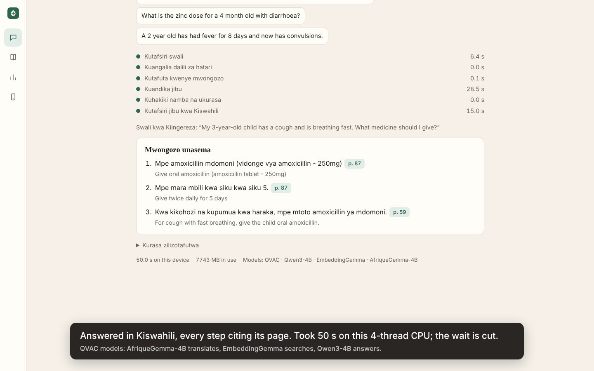

# Tabibu

Tabibu (Swahili for "healer") is an offline assistant for community health promoters. A promoter describes a sick child or asks about a treatment in English or Kiswahili. Tabibu answers from the WHO/UNICEF manual *Caring for the sick child in the community*, cites the page for every step, and flags danger signs that need urgent referral. All of it runs on the promoter's own laptop through [QVAC](https://qvac.tether.io/), with the internet switched off.

**Track: Cloud to Pocket.** Tabibu takes a workflow that today depends on a cloud AI service and moves it onto the device. The benchmark below compares the two on the same questions.



## The problem

Kenya's community health promoters do household visits where signal is weak or data costs money. Reporting on Kenya's electronic Community Health Information System found that promoters buy their own data bundles, often from their stipends, to sync records, and that the system was unusable for one to three months at a time ([Nation, 2025](https://nation.africa/kenya/health/broken-system-how-kenya-s-digital-health-revolution-is-failing-on-the-frontline-5291546); [PLOS One, 2026](https://journals.plos.org/plosone/article?id=10.1371%2Fjournal.pone.0358994)). Swahili AI support is weak in most tools ([GSMA via Techpoint, 2026](https://techpoint.africa/news/africa-ai-language-models/)). Existing AI help for Swahili speakers, such as Jacaranda Health's PROMPTS helpdesk for mothers, runs on servers and reaches people by SMS ([IDRC](https://idrc-crdi.ca/en/stories/technology-support-maternity)).

A promoter standing in a home with a sick child needs the right dose and the danger signs now, in their language, without spending data, and without sending a family's health details to a server.

## The cloud workflow, and what moved

**Before (cloud):** the question goes to a hosted large language model. It translates Kiswahili, reads guideline excerpts, writes the answer and decides whether to refer. Each question needs a connection, sends the child's details off the device, and costs money per call. `eval/cloud.js` implements this workflow with `claude-sonnet-5-5` so the comparison is measured, not described.

**After (Tabibu):** every step runs on the device through QVAC.

| Step | Cloud workflow | Tabibu on device |
|---|---|---|
| Kiswahili to English | Cloud LLM | `AFRICAN_4B_TRANSLATION_Q4_K_M` (AfriqueGemma-4B) via QVAC |
| Danger signs | Cloud LLM decides | Fixed rules from the manual's danger-sign pages, run on the original question and its translation and each citing its page; no model decides |
| Guideline search | Same local index in both | `EMBEDDINGGEMMA_300M_Q8_0` via QVAC, exact cosine search |
| Answer | Cloud LLM, JSON | `QWEN3_4B_Q4_K_M` via QVAC, JSON schema enforced by QVAC's grammar support |
| Checks | Same checks in both | Every number in a step must appear on the cited page. A dose row whose age band excludes the child's age is removed. |
| English to Kiswahili | Cloud LLM | AfriqueGemma-4B via QVAC |

## Results

<!-- results:start -->
On-device results through QVAC. The cloud column fills in after running npm run eval -- --backend=cloud with an API key on this machine.

| Measure | On device, run 1 (before fixes) | On device, run 2 (Qwen3-4B) | Light option on device (Qwen3.5-2B) | Cloud (claude-sonnet-5-5) |
|---|---:|---:|---:|---:|
| Guideline answers with every expected fact | 17/22 | 20/22 | 14/22 | — |
| Answer cites the page that states it | 16/22 | 19/22 | 14/22 | — |
| Kiswahili questions answered in Kiswahili | 7/8 | 8/8 | 5/8 | — |
| Danger signs that triggered urgent referral | 10/11 | 11/11 | 11/11 | — |
| Exact danger sign named, with page | 10/11 | 11/11 | 11/11 | — |
| Referral raised with no danger sign | 0/29 | 0/29 | 0/29 | — |
| Out-of-scope questions refused | 8/8 | 8/8 | 8/8 | — |
| Steps removed by verification (number not on page, or wrong age row) | 9 of 103 | 9 of 109 | 5 of 74 | — |
| Median time per question | 35.8 s | 36.0 s | 17.7 s | — |
| 90th percentile time | 60.8 s | 64.2 s | 43.1 s | — |
| Data sent off the device per question | 0.0 KB | 0.0 KB | 0.0 KB | — |
| Cost per 1,000 questions | $0.00 | $0.00 | $0.00 | — |
| Peak memory on device | 7.2 GB | 7.4 GB | 5.8 GB | — |
| Works with the internet off | Yes | Yes | Yes | — |
| Errors | 0 | 0 | 0 | — |

40 questions from eval/questions.json (22 guideline answers, 10 danger-sign cases, 8 out-of-scope), written by the developer before the first run. Measured on Intel(R) Xeon(R) Processor @ 2.10GHz (4 threads), 16 GB RAM, linux 6.18.44-fc-v185, 2026-10-29, inside a Linux network namespace with no network interface. Raw per-question results are in `eval/results/`. A dash means not measured.

Run 1 exposed two problems: the model sometimes quoted the dose row for the wrong age (the age check removed those rows, leaving the answer without a dose), and one phrasing of swollen feet was missed. Between runs, Tabibu began quoting the right-age row from the same page, the swollen-feet rule was widened, and the refusal threshold was set from run 1's score gap. These fixes were made after seeing run 1 on the same questions, so run 2 may overstate performance on new questions.
<!-- results:end -->

## Try it

Requirements: Node.js 22 or newer, about 8 GB of free disk space, and 8 GB of RAM (16 GB recommended). Setup needs the internet once; after that nothing does.

**Windows (PowerShell):**

```powershell
git clone https://github.com/nftkingiii/qvac.git tabibu
cd tabibu
npm install
npm run setup
npm start
```

**macOS / Linux:**

```bash
git clone https://github.com/nftkingiii/qvac.git tabibu && cd tabibu
npm install
npm run setup
npm start
```

Then open http://localhost:4317 and switch the internet off.

- `npm run ask -- "Mtoto ana homa kwa siku nane"` asks from the terminal.
- `HOST=0.0.0.0 npm start` serves the app to a phone on the same Wi-Fi or hotspot. The models still run on the laptop.
- On an 8 GB machine, set `TABIBU_CHAT=qwen3.5-2b` for a smaller answer model, or `TABIBU_WARM=embed,chat` to load the translator only when a Kiswahili question arrives.
- `npm run eval` runs the benchmark on the device. `npm run eval -- --backend=cloud` runs the cloud baseline. It needs `ANTHROPIC_API_KEY` set in your own shell; never paste a key into a chat or commit it.

## QVAC integration

- **SDK:** `@qvac/sdk` 0.22.0 (JavaScript, running on Node.js; QVAC runs models in its own `bare` worker process).
- **Models**, all from the QVAC model registry. `npm run setup` downloads each file over HTTPS and checks its SHA-256 against the checksum pinned in `@qvac/sdk`. `npm run setup -- --registry` uses the QVAC P2P registry instead.

| Job | Registry constant | File | Size | Licence |
|---|---|---|---|---|
| Answer | `QWEN3_4B_Q4_K_M` | `Qwen3-4B-Q4_K_M.gguf` | 2.50 GB | Apache-2.0 |
| Translation | `AFRICAN_4B_TRANSLATION_Q4_K_M` | `AfriqueGemma-4B.Q4_K_M.gguf` | 2.87 GB | CC-BY-4.0 (McGill-NLP/AfriqueGemma-4B, built on Gemma 3) |
| Search | `EMBEDDINGGEMMA_300M_Q8_0` | `embeddinggemma-300M-Q8_0.gguf` | 0.33 GB | Gemma Terms of Use |
| Light answer option | `QWEN3_5_2B_MULTIMODAL_Q4_K_M` | `Qwen3.5-2B-Q4_K_M.gguf` | 1.28 GB | Apache-2.0 |

- **Where QVAC is used:**
  - `src/qvac.js`: `loadModel`, `completion` (with a JSON schema `responseFormat`), `embed`, `unloadModel`
  - `src/store.js`: embedding the manual and each question
  - `src/pipeline.js`: translation and answer generation
  - `scripts/setup.js`: registry checksums and the optional registry download
- **Loading:** models load from local files with `load_mode: 'none'`. In testing this cut the worker's resident memory from 8.3 GB to 5.8 GB, because weights were otherwise counted both as a mapped file and as a repacked copy.

## Device, memory and limits

- **Built and measured on:** Linux x86-64 (Intel Xeon @ 2.10 GHz, 4 threads), 16 GB RAM, CPU only, no GPU. Numbers are in the Results table.
- **Memory:** measured peak was 7.4 GB with all three models (Qwen3-4B) and 5.8 GB with the light answer model, so 16 GB RAM is comfortable and 8 GB is tight. With `TABIBU_WARM=embed,chat`, the 2.9 GB translator stays unloaded until a Kiswahili question arrives (not separately measured).
- **Speed:** CPU-only answers take tens of seconds, and a Kiswahili answer takes longer because it is translated in and out. A laptop with a GPU or Apple silicon will be faster through QVAC's GPU backends; that was not measured here.
- **Hardware limit:** this is a laptop app. A phone build through QVAC's Expo support is possible future work and was not built or tested.

## What still needs a network

- `npm run setup`: downloads the models (from Hugging Face, checked against QVAC registry checksums) and the WHO manual (from WHO).
- `npm run eval -- --backend=cloud`: the cloud baseline, by design.
- The "Check connection" chip in the app: when clicked, it tries a DNS lookup to report whether the device is online. The answer path never uses it.

Nothing else touches the network. The local benchmark was run inside a Linux network namespace with no network interface (`unshare -n`), so the on-device results come from a process that could not reach the internet.

## Safety

Tabibu is decision support that quotes a training manual, not a diagnostic device. It never answers outside the loaded guideline. Danger signs come from fixed rules, not from a model. Steps whose numbers are not on the cited page, or whose dose row is for a different age band, are removed and listed under "Removed by verification". The manual is the 2011 WHO/UNICEF edition; national guidance may differ and takes precedence. The Kiswahili interface text was written by the developer and has not yet been reviewed by a native-speaking health worker.

## What was built during the event, and what was reused

Everything in this repository was written during AI Yako (24–30 October 2026). No earlier code was reused. Third-party work:

- [`@qvac/sdk`](https://www.npmjs.com/package/@qvac/sdk) and its model registry (Tether), Apache-2.0
- Models listed above, under their own licences
- [`pdfjs-dist`](https://github.com/mozilla/pdf.js) (Mozilla) for PDF text extraction, Apache-2.0
- [`@anthropic-ai/sdk`](https://github.com/anthropics/anthropic-sdk-typescript), used only by the cloud baseline in `eval/`, MIT
- *Caring for the sick child in the community: Participant manual*, © WHO 2011, all rights reserved. It is downloaded from WHO at setup time and never redistributed in this repository.

## Licence

Apache-2.0 for the code in this repository. See `LICENSE`.
